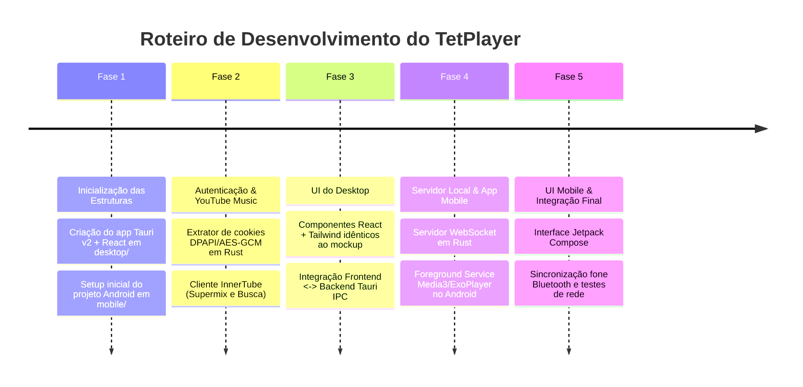

# TetPlayer — Especificações Técnicas e Arquitetura

## 1. Visão Geral e Problema a Resolver
* **Cenário:** O computador não possui conectividade Bluetooth direta (ou o usuário prefere não sobrecarregar o PC com dongles), e utiliza fones de ouvido sem fio pareados ao smartphone. Manter um navegador web aberto no PC apenas para ouvir música no YouTube consome recursos excessivos de CPU e memória RAM (geralmente > 600MB a 1GB).
* **Solução:** Criar o ecossistema pessoal **TetPlayer**, ultra-leve e integrado, dividido em:
  1. **Desktop App (PC Hub):** Funciona como Hub central e player com interface moderna dark idêntica ao YouTube Music Premium, consumindo pouquíssima memória (< 50MB de RAM), com extração automática de cookies de sessão de navegadores locais e controle total da fila e da reprodução.
  2. **Mobile App (Celular Receptor):** Aplicativo Android nativo que atua como receptor de áudio em segundo plano conectado via Wi-Fi local ao PC, enviando o áudio para o fone Bluetooth pareado com tela apagada e controles na tela de bloqueio.
  3. **Comunicação em Tempo Real:** Protocolo bidirecional via WebSocket na rede local (com descoberta mDNS), permitindo sincronização instantânea de estado, volume, seek e comandos de mídia.

---

## 2. Tecnologias e Decisões de Stack

### A. Desktop (`desktop/`)
* **Backend:** **Tauri v2 + Rust**
  * *Motivo:* Consumo mínimo de recursos (< 50MB RAM), binário nativo compilado, alta segurança e acesso direto às APIs do Windows (DPAPI, SQLite de cookies, servidores TCP/WebSocket assíncronos via Tokio).
* **Frontend:** **React 18/19 + TypeScript + Vite + Tailwind CSS**
  * *Motivo:* Interface moderna, responsiva, fidelidade visual de 100% ao mockup dark (`docs/mockup_preview.html`), com tipagem estrita e renderização otimizada via WebView nativo do sistema operacional (Edge WebView2 no Windows).

### B. Mobile (`mobile/`)
* **Stack:** **Android Nativo em Kotlin com Jetpack Compose**
* **Motor de Áudio:** **AndroidX Media3 (ExoPlayer)**
  * *Motivo:* A mesma stack de referência oficial utilizada pelo Google no YouTube Music e Spotify no Android. Oferece:
    * `MediaSessionService` / `Foreground Service` robusto com *Partial WakeLock* (reprodução ininterrupta com tela desligada).
    * Notificação de mídia nativa no sistema com controles de playback e exibição de capa (*artwork*).
    * Gerenciamento de buffers de áudio de alta taxa de bits (AAC / Opus).
    * Interação com botões físicos do fone Bluetooth (AVRCP).

---

## 3. Diagrama de Arquitetura do Ecossistema

```mermaid
graph TD
    subgraph "Navegador Local (Windows)"
        BrowserCookies[("Cookies SQLite\nChrome / Edge / Brave")]
    end

    subgraph "PC Desktop (Tauri + Rust + React)"
        subgraph "Tauri Rust Core"
            CookieExtractor["Extrator DPAPI / AES-GCM\n(Cookies YT Premium)"]
            InnerTube["Cliente YouTube Music\n(InnerTube API)"]
            LocalServer["Servidor Local\n(WebSocket + HTTP Stream)"]
            NativeAudio["Motor de Áudio Local\n(Opcional: PC Speakers)"]
        end
        subgraph "React Frontend"
            UI["Interface Dark Modern\n(React + Tailwind CSS)"]
        end
    end

    subgraph "Smartphone Android (Kotlin + Compose)"
        subgraph "Mobile App"
            WSClient["Cliente WebSocket\n(Sincronização Bidirecional)"]
            Media3Service["Media3 MediaSessionService\n(ExoPlayer Background)"]
            ComposeUI["Interface Now Playing\n(Jetpack Compose)"]
        end
        Headphones["🎧 Fone Bluetooth"]
    end

    BrowserCookies -->|Leitura & Descriptografia| CookieExtractor
    CookieExtractor --> InnerTube
    InnerTube --> LocalServer
    UI <-->|Tauri IPC| Tauri Rust Core
    LocalServer <-->|Wi-Fi Local (WebSocket)| WSClient
    LocalServer -.->|Audio Stream URL / Proxy| Media3Service
    Media3Service -->|Áudio Bluetooth| Headphones
```

---

## 4. Estrutura de Diretórios do Workspace

```text
TetPlayer/
├── docs/
│   ├── README.md                <- Central e índice de documentação
│   ├── ARQUITETURA.md           <- Este documento com especificações técnicas
│   ├── mockup_preview.html      <- Mockup interativo da UI (PC e Celular)
│   ├── desktop/                 <- Documentação específica Desktop (SUGESTOES.md, CORRECOES.md)
│   └── mobile/                  <- [Futuro] Documentação específica Mobile
│
├── .agents/                     <- Governança de agentes, regras e skills (Antigravity)
│   ├── rules/code_writer.md     <- Regra permanente de implementação sênior com zero regressões
│   └── skills/reviewer/SKILL.md <- Skill de auditoria estática, segurança e UX inspection
│
├── desktop/                     <- Aplicação Desktop (Tauri + Rust + React/TypeScript)
│   ├── src-tauri/               <- Backend Rust
│   │   ├── Cargo.toml           <- Dependências Rust (tokio, axum/tungstenite, rusqlite, aes-gcm, etc.)
│   │   ├── tauri.conf.json      <- Configuração do Tauri v2
│   │   └── src/
│   │       ├── main.rs          <- Entrypoint da aplicação Tauri
│   │       ├── auth/            <- Leitura de cookies Chromium, DPAPI e descriptografia AES-GCM
│   │       ├── ytm/             <- Cliente InnerTube API do YouTube Music (playlists, supermix, busca)
│   │       ├── server/          <- Servidor WebSocket e HTTP de stream para o app mobile
│   │       ├── audio/           <- Reprodução local opcional no PC (rodio/cpal)
│   │       └── state.rs         <- Gerenciador de estado e fila de reprodução
│   ├── src/                     <- Frontend React + TypeScript
│   │   ├── assets/              <- Ícones, logos e recursos estáticos
│   │   ├── components/          <- Componentes modulares (Sidebar, Header, PlayerBar, TrackCard, etc.)
│   │   ├── hooks/               <- Custom hooks (usePlayer, useWebSocket, useSearch)
│   │   ├── types/               <- Definições de tipos TypeScript (Track, Queue, PlaybackState)
│   │   ├── App.tsx              <- Layout principal correspondente ao mockup do desktop
│   │   ├── main.tsx             <- Entrypoint React
│   │   └── index.css            <- Configurações do Tailwind CSS e temas dark
│   ├── package.json             <- Dependências npm (react, tailwindcss, lucide-react, etc.)
│   ├── tsconfig.json            <- Configurações do compilador TypeScript
│   └── vite.config.ts           <- Bundler Vite integrado com o Tauri
│
└── mobile/                      <- Aplicação Android (Kotlin + Jetpack Compose + Media3)
    ├── build.gradle.kts         <- Gradle root script
    ├── settings.gradle.kts      <- Módulos e repositórios
    └── app/
        ├── build.gradle.kts     <- Dependências (Media3, Compose, OkHttp, Coroutines)
        └── src/main/
            ├── AndroidManifest.xml <- Permissões (FOREGROUND_SERVICE, INTERNET, BLUETOOTH)
            └── java/com/tetplayer/mobile/
                ├── MainActivity.kt        <- Activity principal com Compose
                ├── service/               <- MediaSessionService do Media3 em segundo plano
                │   ├── PlaybackService.kt <- Foreground Service com ExoPlayer
                │   └── MediaNotification.kt <- Notificação nativa persistente
                ├── network/               <- Comunicação com o Desktop Hub
                │   ├── WebSocketManager.kt <- Conexão e reconexão automática
                │   └── DeviceDiscovery.kt <- Descoberta do PC na rede Wi-Fi local
                ├── ui/                    <- Telas e componentes em Jetpack Compose
                │   ├── theme/             <- Cores e tipografia idênticas ao mockup
                │   ├── components/        <- NowPlayingView, Controls, Scrubber
                │   └── MainScreen.kt      <- Tela completa sincronizada
                └── viewmodel/             <- PlayerViewModel gerenciando estado
```

---

## 5. Módulos do Sistema em Detalhes

### A. Autenticação Automática e Extração de Cookies
* **Alvos suportados:** Google Chrome, Microsoft Edge, Brave Browser, Opera/Vivaldi.
* **Caminho dos dados no Windows:**
  * Chrome: `%LOCALAPPDATA%\Google\Chrome\User Data\`
  * Edge: `%LOCALAPPDATA%\Microsoft\Edge\User Data\`
  * Brave: `%LOCALAPPDATA%\BraveSoftware\Brave-Browser\User Data\`
* **Fluxo de Decriptografia:**
  1. Leitura do arquivo `Local State` (JSON) na pasta raiz do navegador para obter a chave criptografada em Base64 (`os_crypt.encrypted_key`).
  2. Remoção do prefixo `DPAPI` (5 primeiros bytes) e chamada à função nativa da API do Windows `CryptUnprotectData` para obter a chave mestra AES de 256 bits.
  3. Abertura do banco SQLite `Network\Cookies` (usando cópia temporária para evitar locks caso o navegador esteja aberto).
  4. Extração dos registros com host `.youtube.com` ou `.google.com` (especialmente `SAPISID`, `__Secure-3PSID`, `LOGIN_INFO`, `SID`, `HSID`, `SSID`).
  5. Descriptografia da coluna `encrypted_value` (prefixos `v10` ou `v20`) via AES-256-GCM usando o nonce/IV de 12 bytes e a chave obtida no passo 2.
  6. Geração do token de autenticação `SAPISIDHASH` com timestamp e hash SHA-1 para as requisições autenticadas na InnerTube API.

### B. Integração com o YouTube Music (InnerTube API)
* Comunicação direta com os endpoints da API oficial interna do YouTube Music (`https://music.youtube.com/youtubei/v1/`):
  * `/browse`: Para buscar o Supermix do usuário, playlists recentes e recomendações personalizadas.
  * `/search`: Busca de músicas, artistas e álbuns.
  * `/player`: Obtenção do manifesto de reprodução e URLs diretas de streaming de áudio em alta qualidade (formato 140 / AAC 128-256kbps ou formato 251 / Opus).
* O backend Rust gerencia o cache e o refresh dos streams para evitar expiração durante a reprodução.

### C. Comunicação em Rede Local (Wi-Fi Sync)
* **Descoberta:**
  * O Desktop anuncia seu serviço na rede local via mDNS (multicast DNS, ex: `_tetplayer._tcp.local.`) ou via broadcast UDP simples na porta de descoberta.
  * O app Mobile escuta ou efetua scan rápido da sub-rede local (`192.168.x.x`) para conectar automaticamente sem necessidade de digitação de IP.
  * Fallback manual: o Desktop exibe o IP local e um QR Code para conexão instantânea caso a rede bloqueie multicast.
* **Protocolo WebSocket:**
  * Mensagens em JSON tipadas com campos de ação e payload:
    * `PING` / `PONG`: Heartbeat a cada 5 segundos para manter a conexão ativa e detectar desconexões.
    * `PLAY_TRACK`: Envia `videoId`, `title`, `artist`, `album`, `artworkUrl`, `streamUrl`, `duration`.
    * `PLAYBACK_COMMAND`: Comandos `PAUSE`, `RESUME`, `NEXT`, `PREVIOUS`, `SEEK`.
    * `SYNC_STATE`: Sincroniza periodicamente tempo atual de reprodução (`currentTime`), status (`PLAYING` / `PAUSED`) e volume.
    * `OUTPUT_ROUTE`: Alterna entre reprodução no PC (`LOCAL_PC`) e reprodução no Celular (`MOBILE_PHONE`).

### D. Reprodução em Segundo Plano no Android (Media3/ExoPlayer)
* **Serviço de Mídia:** `androidx.media3.session.MediaSessionService` associado ao `ExoPlayer`.
* **Notificação do Sistema:** Notificação com `MediaStyleNotification` exibindo a arte do álbum, título, artista e botões de ação (play/pause/skip) conectados à sessão.
* **Controles Físicos:** Botões do fone de ouvido Bluetooth acionam callbacks no `MediaSessionCompat` / `Player.Listener`, que automaticamente enviam os eventos correspondentes via WebSocket para o Desktop.
* **WakeLock:** Uso de `WAKE_LOCK` em nível de serviço de áudio para evitar que o Android Doze Mode encerre a execução quando a tela for bloqueada.

---

## 6. Fidelidade Visual e Design System

Conforme detalhado no `docs/mockup_preview.html`, a identidade visual adota:
* **Tema:** Dark Premium inspirado no YouTube Music / Spotify.
* **Paleta de Cores:**
  * Fundo Principal: `#0b0c10`
  * Superfícies / Cards: `#12141c`, `#171a24`
  * Bordas e Divisórias: `#232733`, `#1f232e`
  * Destaque / Acentos: Vermelho YouTube `#ef4444` / `#dc2626`
  * Status e Sincronização: Verde Esmeralda `#10b981` / `#059669`
  * Textos: Branco `#ffffff`, Cinza Claro `#e0e2ec`, Secundário `#8c91a4`, Muted `#555a6d`
* **Feedback de Estados:** Skeleton loaders para buscas e playlists, badges de conexão Wi-Fi e fone Bluetooth com animação sutil de pulso, scrubbers deslizantes com preview de tempo.

---

## 7. Roteiro de Implementação (Passo a Passo)



1. **Fase 1: Inicialização dos Projetos Base**
   * Configuração do template do Desktop: Tauri v2 + React + TypeScript + Tailwind CSS em `desktop/`.
   * Configuração da estrutura básica do Android com Gradle, Kotlin e Jetpack Compose em `mobile/`.
2. **Fase 2: Motor Rust de Autenticação e YouTube Music**
   * Criação do módulo de extração segura de cookies de navegadores locais com DPAPI no Windows.
   * Criação do cliente de chamadas autenticadas na InnerTube API (busca, Supermix e streams).
3. **Fase 3: Construção da Interface do Desktop**
   * Implementação completa dos componentes React com Tailwind CSS seguindo exatamente o `mockup_preview.html`.
   * Conexão dos comandos do Tauri com o estado da UI (busca, playlists, controles de playback).
4. **Fase 4: Servidor Local e Motor de Áudio Mobile (Media3)**
   * Criação do servidor WebSocket em Rust no Desktop.
   * Criação do `PlaybackService` com `Media3/ExoPlayer` no Android para receber o stream e tocar em segundo plano.
5. **Fase 5: Interface Mobile em Jetpack Compose e Sincronização Global**
   * Criação da tela "Now Playing" no celular com visual dark e badges de status.
   * Validação da sincronização em tempo real (seek, volume, play/pause pelos botões do fone Bluetooth).
